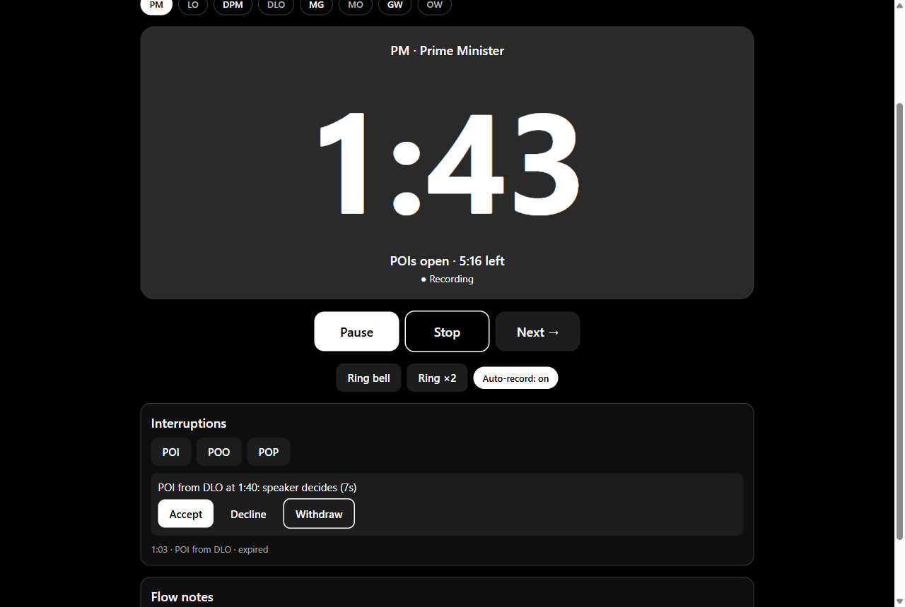
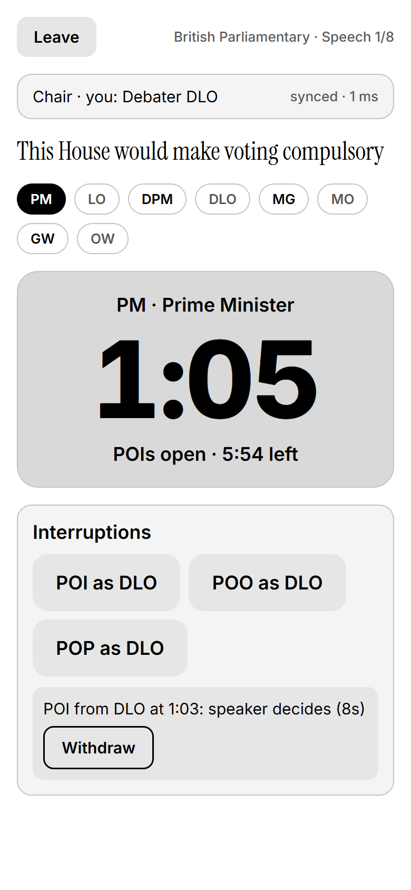
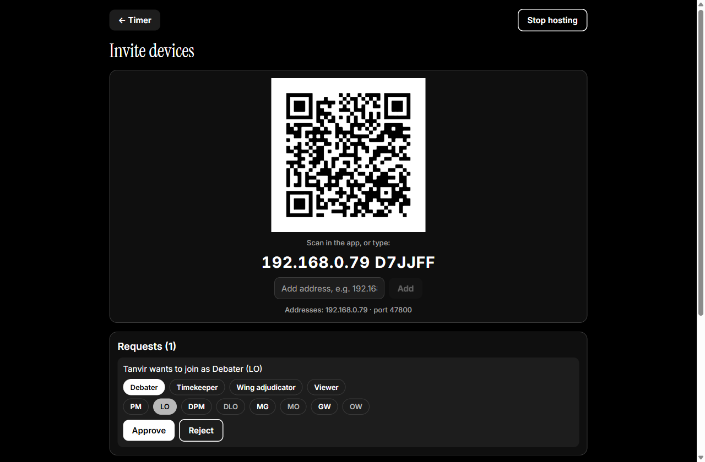
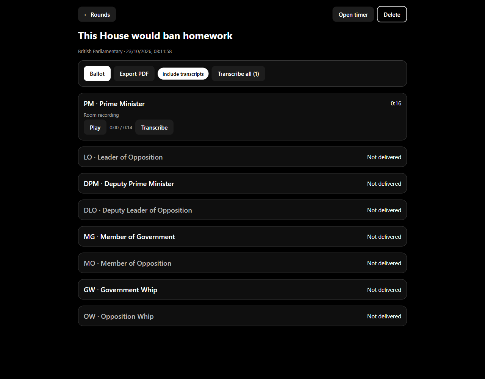
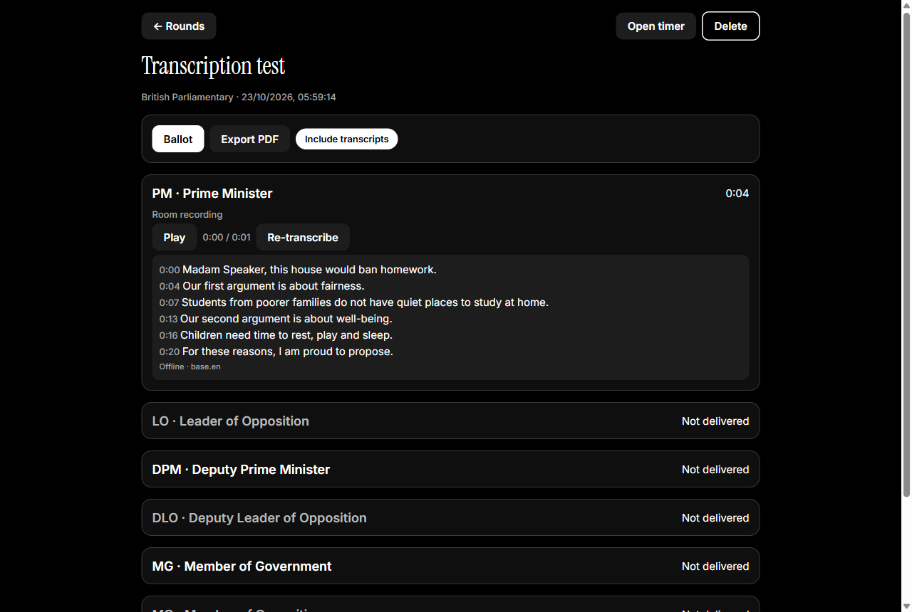

<h1>
  <picture>
    <source media="(prefers-color-scheme: dark)" srcset="docs/brand/lockup-white.svg">
    
  </picture>
</h1>

[](https://github.com/The-Studio-of-Sadiq/debate-adjudicator/actions/workflows/ci.yml)
[](LICENSE)

[](https://the-studio-of-sadiq.github.io/debate-adjudicator/)

An offline-first app for running debate rounds. The chair adjudicator's phone or
laptop runs the room: a synced timer and bells on every device over local
Wi-Fi, POIs and points of order raised from debaters' phones, recordings,
offline transcription, ballots and a PDF report. No accounts, no cloud needed.

Built for **British Parliamentary**, **UADC 7-7-7-4 and 5-5-5-3 (Asian Parliamentary)** and
**World Schools (WSDC)**, plus 45 more formats from the
[Debatekeeper format library](https://github.com/czlee/debatekeeper-formats)
(Australs, Canadian, American Parliamentary, and school and league formats).
Every time, bell and range is editable.

<p align="center">
  
  
</p>

## Features

- **Timekeeping:** 49 formats with a searchable picker ([full list](https://the-studio-of-sadiq.github.io/debate-adjudicator/formats/); add more with a [format definition](docs/wiki/Adding-a-format.md)), phase display (protected, POIs open,
  wrap up, grace, overtime), scheduled and manual bells, editable bell plans.
- **Local multi-device rooms:** join by QR code or typed code over the room's
  Wi-Fi or a phone hotspot; the chair approves each device and assigns roles
  (debater seat, timekeeper, wing adjudicator, viewer). Every device shows the
  same second and rings bells together.
- **Interruptions:** POI, Point of Order and Point of Personal Privilege raised
  from debaters' phones; the speaker accepts or declines POIs, the chair rules
  on the rest, and the clock pauses while a point is heard.
- **Recording:** the chair records each speech; a debater's phone records their
  own accepted POI or point and sends it to the chair.
- **Transcription:** offline Whisper on Android and Windows, or a
  cloud provider when online (ElevenLabs Scribe, OpenAI or Groq); English, and
  Bangla through the cloud. Tap a transcript line to hear it.
- **Adjudication:** timestamped flow notes, ballots for every format with ranks or
  winner computed from speaker scores, and a printable PDF report.
- **Private by design:** notes, ballots and transcripts never leave the chair's device.
- **Light and dark** monochrome themes. The interface is in **English and
  Bangla (বাংলা)** and follows the device's language; more languages welcome.

| Lobby | Ballot | Transcript |
|---|---|---|
|  |  |  |

## Install

Download from [Releases](https://github.com/The-Studio-of-Sadiq/debate-adjudicator/releases):

- **Android:** `Debate-Adjudicator-<version>.apk`. Open it on the phone and
  allow installs from your browser or file manager when Android asks.
- **Windows:** `Debate-Adjudicator-Setup-<version>.exe` installs the app;
  `Debate-Adjudicator-<version>-portable.exe` runs without installing. The
  files aren't code-signed yet, so Windows SmartScreen may warn: choose
  **More info → Run anyway**.

`SHA256SUMS.txt` in each release lets you check the downloads.

### Building it yourself

**Android:** build an APK in the cloud (free Expo account):

```bash
cd apps/app
npx eas-cli@latest login
npx eas-cli@latest build -p android --profile preview
```

**Windows:** run from a clone, or build the installer into
`apps/desktop/release/`:

```bash
npm install
npm run desktop
npm run dist -w desktop
```

## Using it

1. **Chair:** start a round, tap **Invite devices** and show the QR code.
2. **Everyone else:** tap **Join**, pick a role (and seat, for debaters), then
   scan the QR, either in the app or with the phone's normal camera.
3. **Chair:** approve each request, then run the speeches.
4. After the round: **Transcribe all**, fill in the **Ballot**, **Export PDF**.

If devices can't see each other, the venue Wi-Fi is probably isolating them:
use the chair's phone hotspot instead. The lobby can show a Wi-Fi QR code for it.

More detail is in the [docs](https://the-studio-of-sadiq.github.io/debate-adjudicator/docs/).

## Development

```bash
npm install            # also downloads the Electron binary
npm test               # core unit and network tests
npm run typecheck
npm run check:i18n     # every t('…') key exists in the English dictionary
npm run web            # UI in a browser at http://localhost:8081
npm run desktop:dev    # Electron window on top of the running `npm run web`
npm run desktop        # build the web bundle and open it in Electron
npm run android        # Expo dev server for Android
npm run site           # build the website into site-dist/
npm run brand          # regenerate logo files and app icons
```

| Path | Contents |
|---|---|
| `packages/core` | Pure TypeScript: formats, timer, bells, interruptions, ballots, session reducer, LAN protocol. Unit tested. |
| `apps/app` | Expo (React Native) app for Android, also built for web. |
| `apps/app/modules/audio-decoder` | Local Expo module (Kotlin) that decodes recordings for Whisper. |
| `apps/desktop` | Electron shell for Windows: LAN sockets, storage, Whisper and PDF export over IPC. |

Android features that use native code (networking, recording, transcription)
need a development or preview build, not Expo Go.

### Testing host + client on one PC

```bash
npm run export:web -w app
cd apps/desktop
npx electron . --profile=host
npx electron . --profile=client
```

`--profile` gives each instance its own storage and device id. In the host
window, start a round and open **Invite devices**. In the client, choose
**Join** and type the code shown under the QR. The first time it hosts, Windows
may ask to allow the app through the firewall; allow it on private networks.

## Documentation

- [Website](https://the-studio-of-sadiq.github.io/debate-adjudicator/): overview, formats and the docs online
- [Docs home](docs/wiki/Home.md): guides for chairs, debaters, transcription,
  ballots and troubleshooting
- [Brand](docs/brand/README.md): logo, typography and how to regenerate assets
- [PLAN.md](PLAN.md): design, protocol and roadmap
- [CHANGELOG.md](CHANGELOG.md)

## Contributing

Contributions are welcome. Read [CONTRIBUTING.md](CONTRIBUTING.md) and the
[Code of Conduct](CODE_OF_CONDUCT.md). Report security issues privately as
described in [SECURITY.md](SECURITY.md).

## License

[MIT](LICENSE) © The Studio of Sadiq

### Credits

Timings for the imported formats come from the
[Debatekeeper format library](https://github.com/czlee/debatekeeper-formats),
© 2021 Chuan-Zheng Lee and other contributors, used under the MIT License (its
full notice is in `packages/core/src/formats/debatekeeper.ts`).
